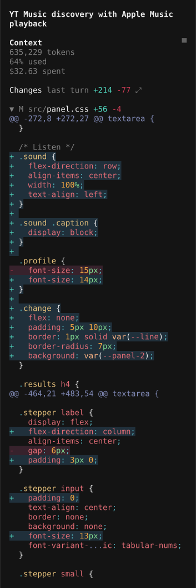
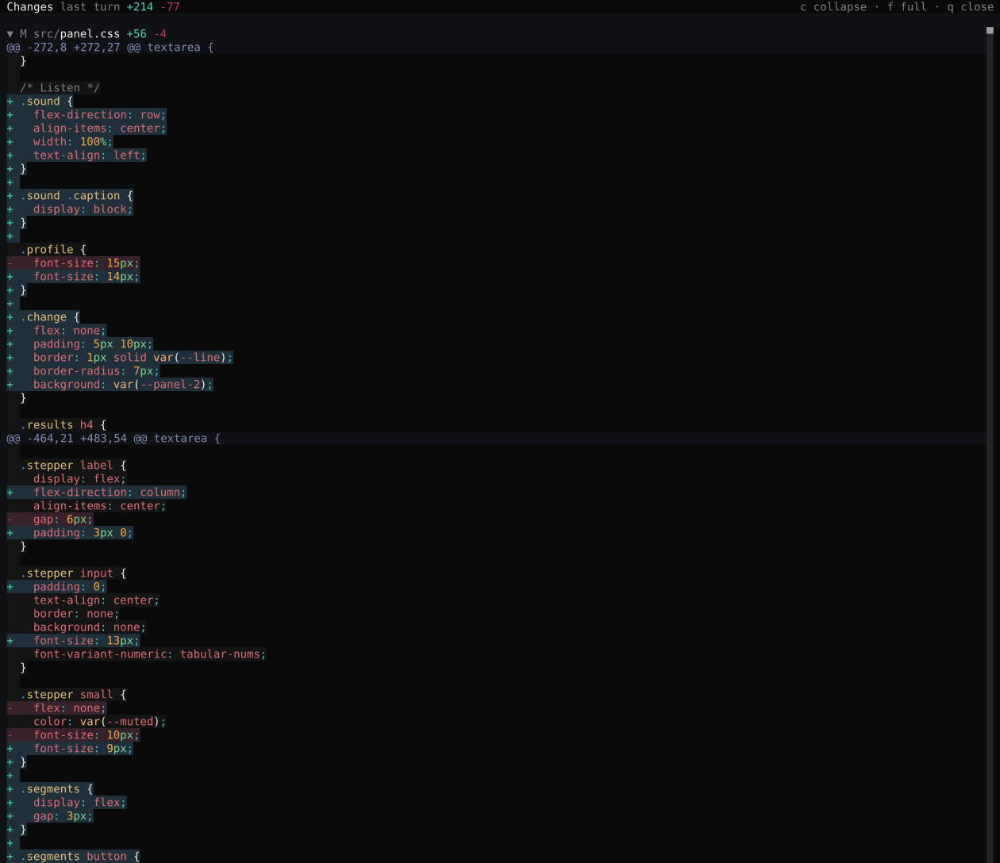

# opencode-diff-sidebar-panel

OpenCode opens `/diff` on a whole screen. That's right for a careful review, and
too much for a quick check of what you just edited.

This plugin puts a compact unified diff in the session sidebar instead, so it
stays in view while you keep working. When 42 columns is not enough, click the
header and the same diff opens in a side panel you can drag to any width.

## What it looks like

The sidebar, on a real session:



The same diff in the panel, opened from the header and shown full screen with
`f`:



Both are straight captures from a real window. The larger generated files in
that session are folded away so several of them fit on one screen, and clicking
a file header does the same in yours.

## Features

- A compact unified diff in the sidebar, with one block per file, the directory
  dimmed, the filename in full, and `+N` and `-M` counts on the right.
- A resizable side panel for when 42 columns is not enough. Same diff, more
  room, and `f` takes over the window.
- Syntax highlighting for every language OpenCode can highlight, using the
  colours from your own theme, with nothing extra to install.
- Files that fold. Click a header to fold one, or press `c` in the panel to fold
  them all. A folded file stays folded through a refresh.
- Two sources: the working tree by default, or what the session changed in its
  last turn.
- It keeps itself up to date. The list refreshes when a turn finishes, and a
  slow poll picks up edits you make by hand.

## Requirements

- OpenCode v2.0.0 or newer. The plugin uses the v2 TUI plugin API and there is
  no V1 build.
- A project under git, or another version control system, for the working tree
  source.

## Install

It is one file and there is no build step. Clone it wherever you keep plugins
and point your CLI config at it:

```sh
git clone https://github.com/wyndhamharyata/opencode-diff-sidebar-panel.git \
  ~/.config/opencode/plugins/diff-sidebar
```

Then add it to `~/.config/opencode/cli.json`:

```json
{
  "plugins": ["./plugins/diff-sidebar"]
}
```

Restart OpenCode and open a session with changes. The Changes block appears in
the sidebar.

<details>
<summary>Installing from somewhere else</summary>

Any path works in `cli.json`: a folder beside the config file, an absolute path,
or a `file://` URL. For instance:

```json
{
  "plugins": ["/Users/you/code/opencode-diff-sidebar-panel"]
}
```

The folder needs its `tui.tsx` entrypoint, which `package.json` lists as the
`./tui` export. There is no `npm install` step. OpenCode hands `@opencode/plugin`,
`@opentui/*` and `solid-js` to a plugin when it loads.

</details>

## Use it

The sidebar block is always there. For the wider view, click **Changes**, click
the `⤢` glyph, or run `/diff-panel`.

| Command | Slash | What it does |
| --- | --- | --- |
| Switch the diff source | `/sidebar-diff` (`/sdiff`) | Show the working tree or the session's last turn |
| Open the diff panel | `/diff-panel` (`/sdp`) | Open the diff in the resizable panel |

Both are in the command palette (`ctrl+p`). You can bind either one to a key by
its command id in `cli.json`, for example
`"keybinds": { "diff-sidebar.panel": "ctrl+shift+d" }`.

Inside the panel:

| Key | What it does |
| --- | --- |
| `f` | Fill the screen with the diff |
| `c` | Fold or unfold every file |
| `s` | Switch the source |
| `q` | Close the panel |

Clicking a file header folds or unfolds it in both views.

## Notes and limits

- The OpenCode v2 sidebar is stuck at 42 columns, and no setting moves it. The
  panel gets around that by using the same pane with a draggable divider, and it
  starts at half the window.
- A long line is shortened, with both ends kept so you can still see where it
  goes.
- Only languages OpenCode recognises get colours. Anything else stays plain.
- No LSP goes into this. LSP describes the current contents of a file, so it has
  nothing to say about deleted lines or about the code around a change.
- Every changed file is listed. The sidebar shows at most 80 lines from one file
  and 400 across the files you have expanded, and the rest becomes a
  "… N more lines" link that opens the panel. The panel shows up to 5000. A
  folded file costs nothing.

## License

MIT. See [LICENSE](LICENSE).
